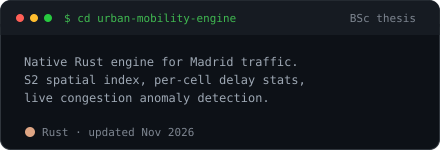
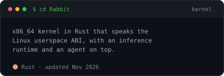
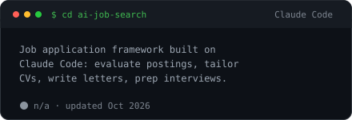
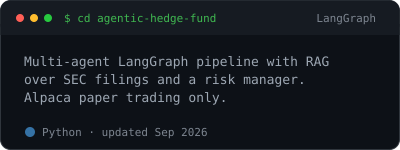
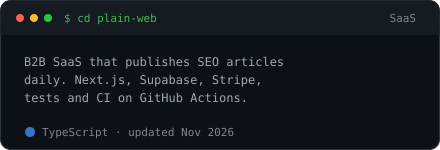
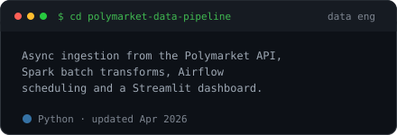

  

**Computer Engineer (BSc 2026). I build data and ML systems in Rust and Python and run them on Linux.**
Based in Zaragoza, Spain. Open to relocation and remote work.

## `$ cat /proc/status`

| | |
|---|---|
| **Role** | Entry level: ML / MLOps, data engineering, backend |
| **Education** | BSc Computer Engineering, Universidad San Jorge (GPA 8.7/10). Erasmus year in Finland |
| **Experience** | Data Scientist / Backend Engineer at Capillar IT: real-time ingestion services in Rust and Python, ETL into a data warehouse |
| **Languages** | Spanish (native), English (C1), French (B1) |
| **Availability** | Immediate. EU citizen, no sponsorship needed in the EU |

## `$ ls ~/projects`

<table>
  <tr>
    <td></td>
    <td></td>
  </tr>
  <tr>
    <td></td>
    <td></td>
  </tr>
  <tr>
    <td></td>
    <td></td>
  </tr>
</table>

## `$ lsmod`

## `$ shutdown -h now`

